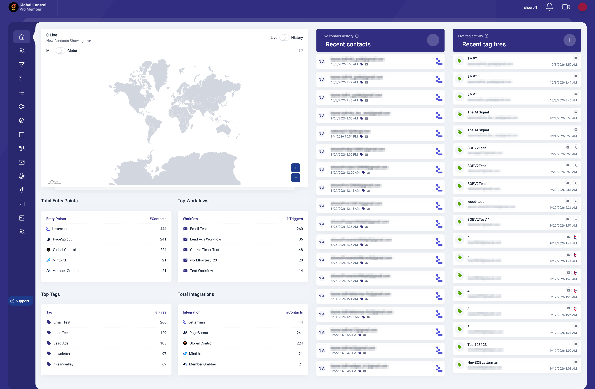
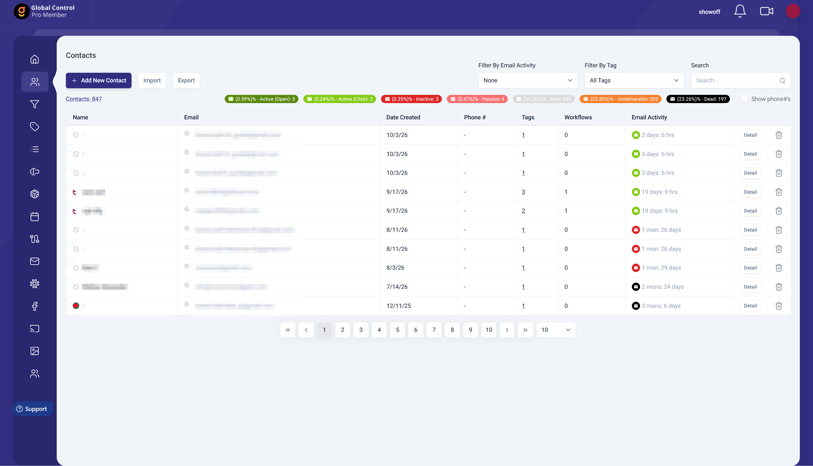
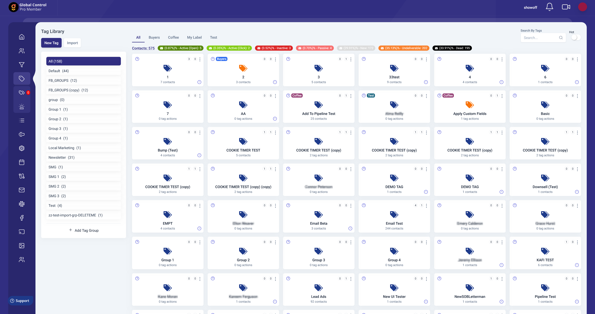
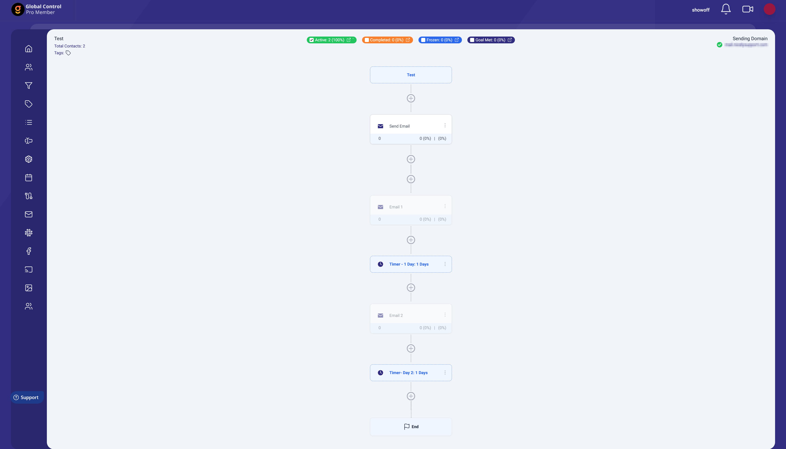
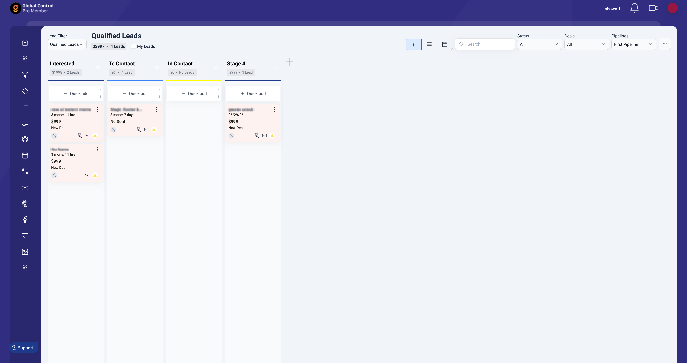
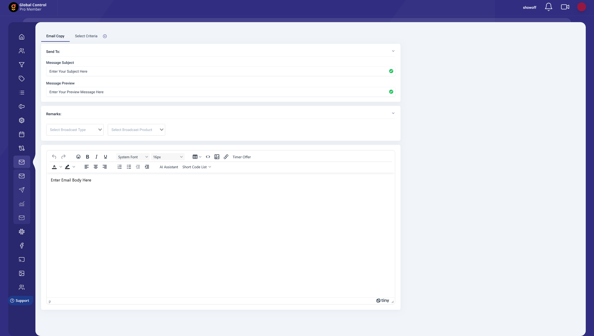
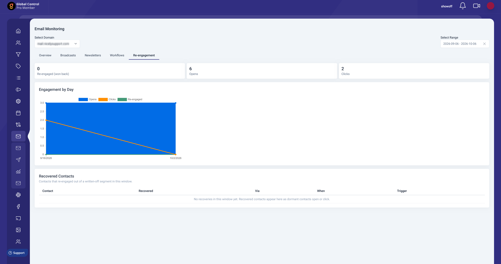
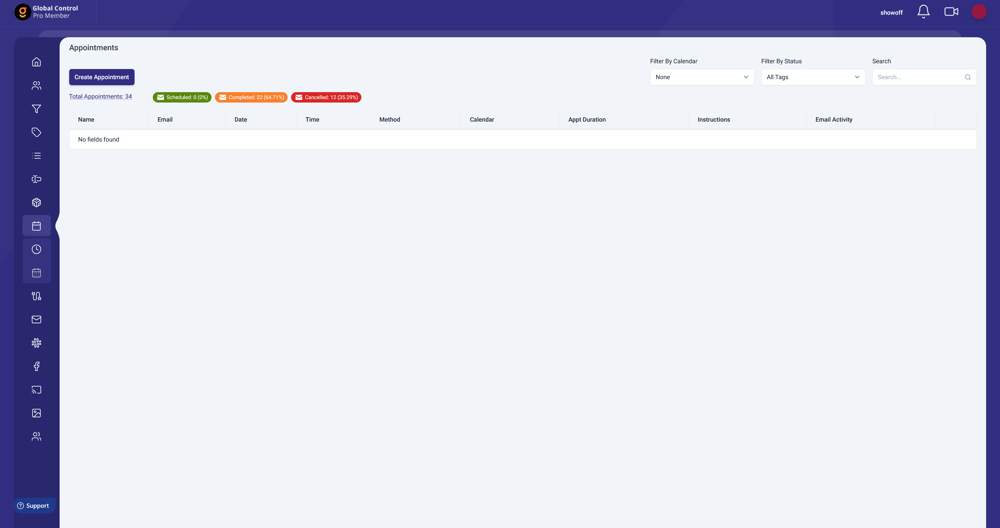
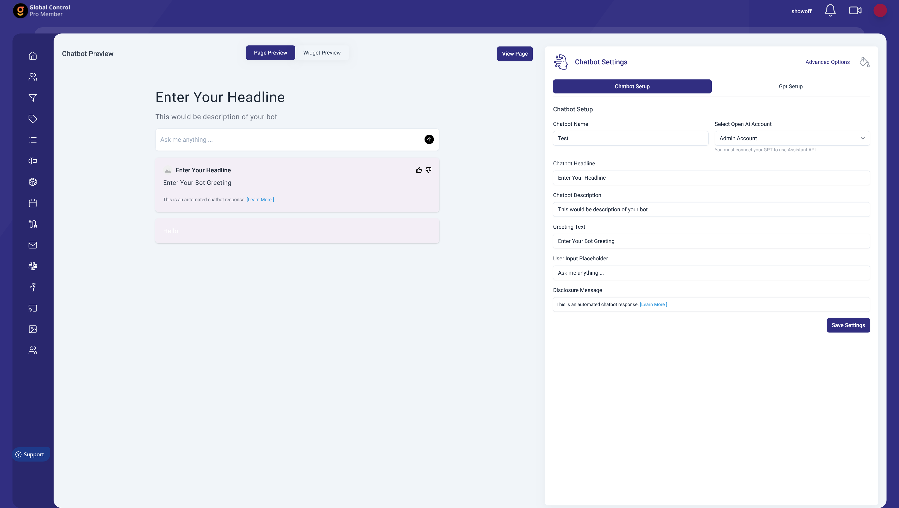
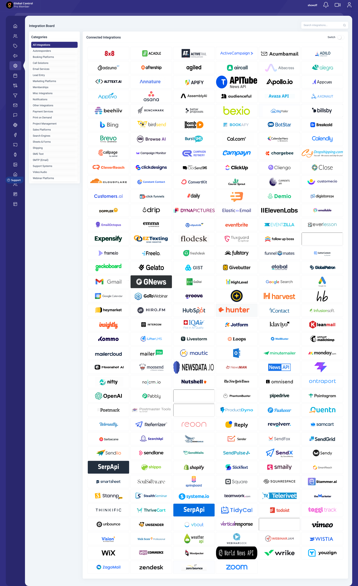

# Global Control Frontend

Documentation for the web frontend of Global Control, a CRM and marketing automation platform for agencies and their clients. The API it talks to is documented in [Global-Control-Server](https://github.com/jsoftsol/Global-Control-Server).

> **The source code is not included in this repository.** This is client work and the code is proprietary. This repo only holds documentation: this README, a reverse-engineered product spec ([PRD.md](PRD.md)), and a folder for screenshots. Everything here was written from a read-through of the actual codebase.

## What it does

Global Control is a single-page app where a business (or an agency running accounts for its clients) manages contacts and automates follow-up. A contact gets tagged, and tags start workflows that send emails and SMS, wait, branch, move people between workflows, or fire third-party integrations. Around that core sit broadcast email, sales pipelines, appointment booking, AI chat bots, reporting, and white-label tools for agencies.

## Screenshots

Taken from a demo account. Email addresses, contact names and the sending domain are pixelated.

**Dashboard.** Live contact and tag activity, entry points, top workflows, tags and integrations.


**Contacts.** Status-segmented contact table with tag filter, search, import and export.


**Tags.** Tag library with groups, labels, contact and tag action counts, and the same status segments as the contact table.


**Workflow.** Step view with email, timer and end nodes, plus active, completed, frozen and goal-met counts.


**Pipeline.** Kanban board with stages, lead cards, deal values and list and calendar views.


**Broadcast email.** Composer with subject, preview text, rich text editor, AI assistant and short codes.


**Email monitoring.** Re-engagement tab with engagement by day and a recovered contacts table.


**Appointments.** Appointment list with calendar and status filters and scheduled, completed and cancelled counts. The table is empty in this demo account.


**AI chat bot builder.** Live preview next to the bot settings, with page and widget modes.


**Integration board.** Catalog of third-party services grouped by category, with search.


## Architecture

```
View / Component  ->  Pinia store  ->  Service layer (Axios)  ->  Backend REST API
                          |
                          +--------->  Socket.io (live events)
```

- Views (about 455 files) map to routes. Feature components sit beside them.
- Pinia stores (76 files) hold shared state per domain.
- A service layer (54 files) wraps every REST call behind one Axios class that adds the bearer token and normalizes responses to `{data}` or `{error}`.
- A single socket store owns the Socket.io connection and exposes listener helpers for queue logs, tag activity, notifications and background processes.
- The backend is a separate project. This repo has no server code.
- Layouts: a main side-menu shell for logged-in users, a separate white-label shell under `/application/:permalink`, and public pages with no shell (booking pages, chat bot embeds, login).

## Tech stack

| Area | Tools |
|---|---|
| Framework | Vue 3 (Composition API, `<script setup>`), Vue Router 4, Pinia |
| Build | Vite 2, plain JavaScript |
| Styling | Tailwind CSS 3, PrimeVue 4 (Aura theme), Midone-based admin template |
| Workflow canvas | Vue Flow |
| Calendar | FullCalendar 5 |
| Charts and maps | Chart.js, amCharts 5, Google Maps loader |
| Rich text | CKEditor 5, TinyMCE, Quill |
| Drag and drop | Draggable libraries for the pipeline board and lists |
| Forms | vee-validate, Vuelidate, Yup |
| Realtime | socket.io-client |
| Data import | PapaParse, SheetJS |
| HTTP | Axios |

Deployment is a manual build followed by a copy to the web server directory. There is no CI pipeline.

## Core features

Each item below was confirmed in the code unless it appears under Known limitations.

- **Contacts.** Searchable table with filters, bulk tag and delete actions, CSV and spreadsheet import, and a detail view with activity, workflows, deals, forms and appointments. Status badges (new, active, inactive, passive, dead, undeliverable) come from a single server field.
- **Tags.** Tags carry groups, labels and actions. Tag activity and failed tags are shown live, and failed tags can be re-fired.
- **Workflows.** A step-based editor and a newer node canvas. Step types: send email, send SMS, timer, conditional timer, split (A/B or condition), add or remove tag, move to another workflow, fire an integration, and set a custom field. Includes groups, cloning, sharing by code, goal tracking, per-workflow sending domain and phone number, and frozen, completed and goal-met views.
- **Broadcast email and SMS.** Recipient counts by engagement status, sending domain or SMTP choice, templates and template groups, an AI writing helper, and engagement and re-engagement campaigns.
- **Reporting.** Email overview, broadcast, newsletter and workflow reports, a re-engagement dashboard (recovered contacts, engagement by day), plus uptime and broadcast monitoring and a live queue log.
- **Pipelines and deals.** Kanban board with stages, drag and drop, won and lost drop zones, activities, lead import and deals.
- **Appointments.** Appointment types with groups, availability rules, buffers, recurrence, time zones and attendee limits, public booking, cancel and reschedule pages, and Google Calendar, Outlook and Zoom connections.
- **AI chat bots.** Bot builder with assistant and model selection, file upload, a full-page mode, an embeddable widget and a public view.
- **Integrations.** A server-driven catalog of integrations with API key or OAuth connection, inbound webhooks (entry points), Facebook lead ads, and Twilio number purchase and management.
- **Lists and fields.** Smart lists, custom lists, custom fields with groups.
- **Agency tools.** Client accounts, white-label branding and login pages, custom domains (CNAME), enterprise sub-users.
- **Libraries.** Image library, QR codes, rewards and reward fulfillment, video onboarding screens.

## Data model

Inferred from services, stores and forms (the database itself lives in the backend):

- **Contact**: name, email, phone, tags, custom fields, `currentStatus`, last email activity, related activities, pipeline leads, workflow queues, appointments.
- **Tag**: group, label, actions (integration action, add or remove tag, start workflow), task states (start, running, failed, completed).
- **Workflow**: ordered flows, queues per contact (frozen, finished, goal met), sending domain, SMS number, goal settings (tags, move-to workflow).
- **Broadcast / campaign**: subject, message, domain or SMTP config, recipient segment by status, linked reports.
- **Pipeline**: groups, stages, leads, deals, pinned activities.
- **Appointment**: slug, type, length, availability, payment settings, calendar sync, bookings.
- **Chat bot**: assistant, model, page path, widget styling, conversations.
- **Integration**: category, authentication type, connected accounts, actions, triggers.
- **Account structure**: user, sub-user, agency client with white-label settings, domain, CNAME domain, SMS number.

## Known limitations

This is an honest list of what a read-through found.

- **Some screens are unfinished.** The billing page is an empty placeholder. The agency purchase page is a bare button. General settings only covers domains. The main chat screen is a static template mockup with no data behind it (the AI chat bot builder is the real chat feature).
- **Dead and duplicate code.** About 55 files from the original admin template are kept in a `the-removed` folder, and roughly 18 backup-style files (`.bak`, `.backup`, `copy`) are tracked in git. Several features exist in two or three versions (workflows, dashboards, integrations, QR codes, phone settings).
- **Logging.** The code has several hundred `console.log` calls, around half of them active.
- **No tests, no linting.** There are no unit or end-to-end tests and no ESLint or Prettier setup.
- **Aging dependencies.** Vite 2, Axios 0.26, Chart.js 2, an old SheetJS release, and a mix of CKEditor versions. There are also overlapping libraries (four rich text editors, three date pickers).
- **Hardcoded hosts.** A handful of views build URLs with fixed API or dev hostnames instead of the environment variable, which breaks those features on other environments.
- **Environment files are tracked in git.** They contain only URLs, no keys, but they should be untracked.
- **No frontend role checks.** Access by plan or role is controlled by menu visibility and the server. Routes carry no role metadata.
- **Some rough edges in logic.** A plan check that always evaluates true, a public-pages list that misses a few intended public routes, and duplicate route names.
- **No internationalization.** All text is English.
- **Manual deploys.** No CI, no automated checks before release.

## Author

Ammad Sarfraz

This repository contains documentation only. The Global Control platform and its source code belong to the client.
